<!--
  The images in this README are generated from profile.json:
    python scripts/build.py   → header, about, stack, projects, footer
    python scripts/stats.py   → stats + languages (refreshed daily by .github/workflows/profile.yml)
  The contribution snake is rendered by .github/workflows/snake.yml into the `output` branch.
-->

<picture>
  <source media="(prefers-color-scheme: dark)" srcset="assets/header-dark.svg">
  <source media="(prefers-color-scheme: light)" srcset="assets/header-light.svg">
  
</picture>

&nbsp;
&nbsp;
&nbsp;

## About me

I'm **Juan Esteban**, a fullstack developer from **Valledupar , Colombia 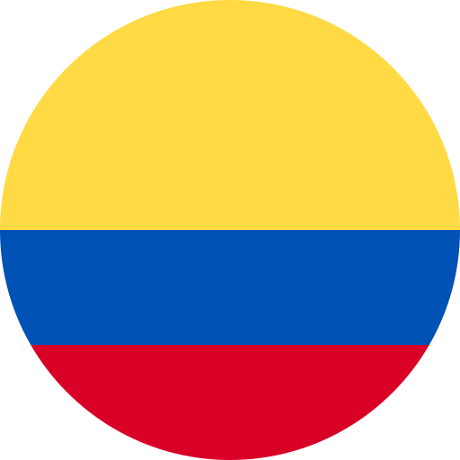**, the land of vallenato. I enjoy owning a product end to end: well-structured APIs, clean and fast interfaces and, lately, data and AI features that turn raw information into decisions.

- 🧱 **Backend:** REST APIs with FastAPI and Spring Boot, hexagonal architecture, JWT auth and PostgreSQL.
- 🎨 **Frontend:** SPAs and dashboards with Angular, React and Next.js, plus 3D on the web with Three.js.
- 📊 **Data & AI:** EDA, clustering and computer vision with Pandas, scikit-learn and OpenCV, and LLM APIs.
- 📱 **Mobile:** cross-platform apps with Flutter.
- ✨ Lover of clean code and good practices, creating (and fixing) bugs since 2022.
- 🤝 Open to work and to collaborating on interesting projects.

<picture>
  <source media="(prefers-color-scheme: dark)" srcset="assets/about-dark.svg">
  <source media="(prefers-color-scheme: light)" srcset="assets/about-light.svg">
  
</picture>

## Tech Stack

<picture>
  <source media="(prefers-color-scheme: dark)" srcset="assets/stack-dark.svg">
  <source media="(prefers-color-scheme: light)" srcset="assets/stack-light.svg">
  
</picture>

## Featured Projects

  <a href="https://github.com/jestebanv30/space-web-frontend">
    <picture>
      <source media="(prefers-color-scheme: dark)" srcset="assets/projects/space-explorer-dark.svg">
      <source media="(prefers-color-scheme: light)" srcset="assets/projects/space-explorer-light.svg">
      
    </picture>
  </a>
  <a href="https://github.com/jestebanv30/omr-dashboard">
    <picture>
      <source media="(prefers-color-scheme: dark)" srcset="assets/projects/omr-dashboard-dark.svg">
      <source media="(prefers-color-scheme: light)" srcset="assets/projects/omr-dashboard-light.svg">
      
    </picture>
  </a>
  <a href="https://github.com/jestebanv30/hackathon-backend">
    <picture>
      <source media="(prefers-color-scheme: dark)" srcset="assets/projects/upc-analytics-dark.svg">
      <source media="(prefers-color-scheme: light)" srcset="assets/projects/upc-analytics-light.svg">
      
    </picture>
  </a>
  <a href="https://github.com/jestebanv30/concesionario-coches-spring">
    <picture>
      <source media="(prefers-color-scheme: dark)" srcset="assets/projects/car-dealership-dark.svg">
      <source media="(prefers-color-scheme: light)" srcset="assets/projects/car-dealership-light.svg">
      
    </picture>
  </a>

  🚀 Live demos:
  <a href="https://space-web-frontend.vercel.app">Space Explorer</a> ·
  <a href="https://omr-dashboard.vercel.app">OMR Dashboard</a> ·
  <a href="https://concesionario-coches-front.vercel.app">Car Dealership</a> ·
  <a href="https://cajero-automatico-angular-firebase.vercel.app">ATM Simulator</a>
  &nbsp;|&nbsp; More in my <a href="https://github.com/jestebanv30?tab=repositories">repositories</a>

## GitHub Stats

<picture>
  <source media="(prefers-color-scheme: dark)" srcset="assets/stats-dark.svg">
  <source media="(prefers-color-scheme: light)" srcset="assets/stats-light.svg">
  
</picture>
<picture>
  <source media="(prefers-color-scheme: dark)" srcset="assets/languages-dark.svg">
  <source media="(prefers-color-scheme: light)" srcset="assets/languages-light.svg">
  
</picture>

  

<picture>
  <source media="(prefers-color-scheme: dark)" srcset="https://raw.githubusercontent.com/jestebanv30/jestebanv30/output/github-snake-dark.svg">
  <source media="(prefers-color-scheme: light)" srcset="https://raw.githubusercontent.com/jestebanv30/jestebanv30/output/github-snake.svg">
  
</picture>

 

<picture>
  <source media="(prefers-color-scheme: dark)" srcset="assets/footer-dark.svg">
  <source media="(prefers-color-scheme: light)" srcset="assets/footer-light.svg">
  
</picture>

